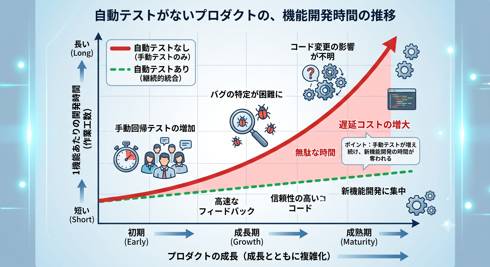

# Phase 2: テスト未整備コードへの pytest 導入

所要時間: 約 15 分

このハンズオンでは、テストがない既存コードに最小限の pytest を導入し、
失敗ログを根拠に修正を反復してテストを安定化させます。

```text
環境準備と現状確認  ->  テスト生成  ->  実行と修正ループ
```

## なぜ自動テストが必要なのか？

### 自動テストがないとプロダクトの成長と共に製品の安定性と開発速度が低下する

開発期間が長期に渡るプロジェクトほど、新機能が増加し、コード量も増え、リリース前に確認すべき事項が増えていきます。

そうすると、手動テストの長時間化が発生し、開発スピードの低下につながります。



システム開発において自動テストが重要な理由は、主に以下の4点に集約されます。

### 1. 開発スピードの高速化（迅速なフィードバック）

コードを変更した直後に、それが正しく動作するかを数秒〜数分で検証できます。手動テストを待つ必要がないため、開発のサイクル（修正→確認）が速くなります。

### 2. デグレード（先祖返り）の防止

新機能の追加や不具合の修正によって、**「過去に正しく動いていた場所が壊れる（デグレード）」のを防ぎます。** コードを変更しても、既存の機能が維持されているかを保証できます。

### 3. バグ修正コストの最小化

バグは「発見が遅れるほど、修正に必要な時間とコストが跳ね上がる」という性質があります。自動テストによって開発の初期段階でバグを検知できれば、手戻りコストを最小限に抑えられます。

### 4. 開発チームの心理的安全性

「コードを触ったら別の場所が壊れるかもしれない」という恐怖がなくなります。これにより、コードの品質を綺麗に保つための改善（リファクタリング）や、大胆な機能追加を安心して進められるようになります。

---

## 02-1. 環境準備と現状確認

ローカル環境で受講している場合は、事前準備で作成した仮想環境（`.venv`）を有効化した状態で進めてください。

> **プロンプト**

- Codespaces で受講している場合

```text
workshop-python を作業ルートにして、
以下を順に実行してください。
1) pip install -r requirements.txt
2) pytest -q
実行結果を要約して報告してください。
```

- ローカル環境で受講している場合

```text
リポジトリ直下の .venv を有効化した状態で実行してください。
workshop-python を作業ルートにして、以下を順に実行してください。
1) python -c "import sys; print(sys.executable)"
2) python -m pip install -r requirements.txt
3) python -m pytest -q
1 の出力に .venv が含まれ、仮想環境の Python であることを確認してください。
実行結果を要約して報告してください。
```

初回はテストがないため、`no tests ran` が表示されれば正常です。

**Copilot の動き**

- 作業ディレクトリを切り替え、依存関係をインストールします。
- `pytest -q` または `python -m pytest -q` を実行し、初期状態のテスト状況を要約します。

✅ **期待する結果**

```text
requirements.txt の依存関係が導入され、
初回実行で no tests ran もしくは現状の失敗内容が把握できる。
```

---

## 02-2. 主要関数のテストを作成する

> **プロンプト**

```text
workshop-python/app/task_service.py を対象に、
pytest のテストファイル
workshop-python/tests/test_task_service.py
を作成してください。

それぞれの関数に対して正常系と異常系のテストを実装してください。
```

**Copilot の動き**

- 各関数に対して正常系と異常系のテストケースを生成します。
- 実行可能な pytest ファイルを作成します。

✅ **期待する結果**

```text
tests/test_task_service.py が作成され、
それぞれの関数に最低1件以上のテストが含まれる。
```

---

## ✅ チェックポイント

- [ ] `tests/test_task_service.py` が作成されている
- [ ] それぞれの関数にテストがある
- [ ] 最終的に `pytest -q` が成功している

---

## 🧹 トラブルシュート

| 症状 | 対処 |
| --- | --- |
| 自動テストが失敗する | 失敗の解消もAIに相談してみてください |

---

次は [phase3.md](phase3.md#phase-3-レビュー属人化を減らす運用整備) に進みます。
