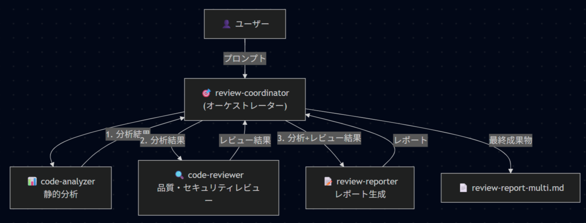
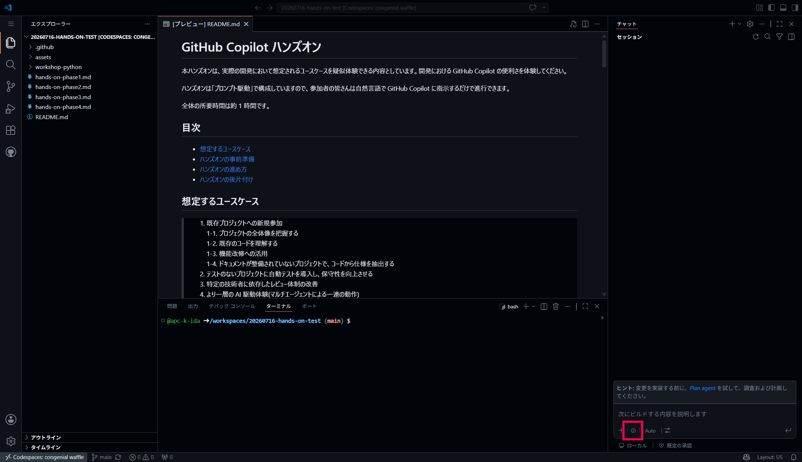

# Phase 4: マルチエージェントによる一連の動作体験

所要時間: 約 15 分

このハンズオンでは、役割分担された Subagent を連携させて、
コード分析からレビュー報告までをパイプラインとして体験します。

---

## 全体像: 今回実行するマルチエージェント



---

## 04-1. マルチエージェントワークフローを実行する

画像右下のエージェントの設定から `review-coordinator` を選択後、下記のプロンプトを送信する。



> **プロンプト**

```text
workshop-python/app/task_service.py をレビューしてください。
```

**Copilot の動き**

- `review-coordinator` エージェントが起動し、Subagent である `code-analyzer`、`code-reviewer`、`review-reporter` を順次呼び出して処理を進めます。

✅ **期待する結果**

```text
review-report-multi.md が生成される。
```

## 04-2. コーディネーターエージェントの中身を確認する

`.github/agents/review-coordinator.agent.md` の中で特に重要なポイントは以下です。

```markdown
---
description: コードレビューパイプラインのコーディネーター。分析・レビュー・レポート生成の各エージェントに Handoff しながらレビューを完成させます。
argument-hint: レビューしたいファイルのパスを指定してください（例: review-target.py）
infer: false
tools: [agent] ← 別のエージェントの呼び出しを可能にします
agents: ["code-analyzer", "code-reviewer", "review-reporter"] ← 呼び出し可能なエージェントを指定
---
```

```markdown
## 手順 (#tool:todo) ← どのサブエージェントを呼び出すか指定しています。

1. #tool:agent/runSubagent で `code-analyzer` エージェントを呼び出し、対象ファイルのパスを渡して静的分析を依頼する
2. 分析結果を受け取り、#tool:agent/runSubagent で `code-reviewer` エージェントを呼び出す。分析結果と対象ファイルのパスを渡してレビューを依頼する
3. レビュー結果を受け取り、#tool:agent/runSubagent で `review-reporter` エージェントを呼び出す。分析結果・レビュー結果・対象ファイルパスを渡して `review-report-multi.md` の生成を依頼する
4. 生成された `review-report-multi.md` のパスをユーザーに通知する
```

---

## ✅ チェックポイント

- [ ] `review-coordinator` からサブエージェントが順次呼び出される
- [ ] `review-report-multi.md` が作成される

---

## 補足

- `description` はエージェント選択時に Copilot が適切なエージェントを判断する際に参照される。役割が明確なほど誤起動が減る
- `argument-hint` はエージェント選択後にチャット欄に表示されるヒントテキスト。ユーザーが何を入力すればよいかを示す
- `tools: [agent]` を含めることで `#tool:agent/runSubagent` が使用可能になり、Subagent 呼び出しが実現する
- `user-invocable: false` を設定したエージェントはユーザーから直接呼出しができず、サブエージェント専用となる

---

## 💡 参考：開発の一連の流れをマルチエージェントに任せる

ウォーターフォールのような開発工程を参考に以下のようなエージェント群を組み合わせることによって一連の開発の流れを自動化することも可能です。

- オーケストレーターエージェント(ユーザーと直接やり取りするエージェント)
- 要件定義エージェント
- 設計エージェント
- 実装エージェント
- テストエージェント
- レビューエージェント

> ⚠️ 注意点: マルチエージェントでは合計の指示出しの回数は減りますが、AIが複数回長時間にわたり動くことになるため、AI Credits(AIC)の消費が激しくなります。
> まずはスモールスタートで検証を重ねることをお勧めします。

---

Phase 4 は以上です。MCP の体験を行う場合は、[Phase 5](phase5.md#phase-5-microsoft-learn-mcp-を使った公式情報の参照) に進みます。

ここで終了する場合は、[ハンズオンの後片付け](README.md#ハンズオンの後片付け) に進んでください。
